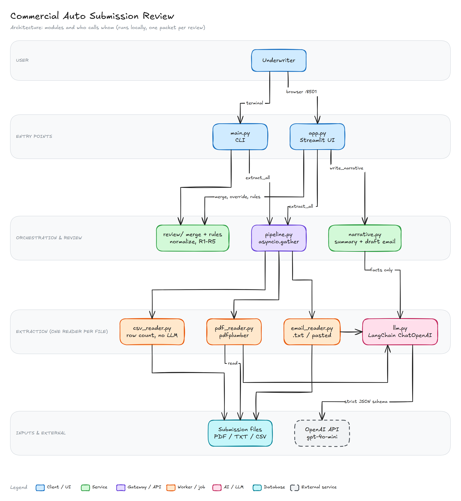
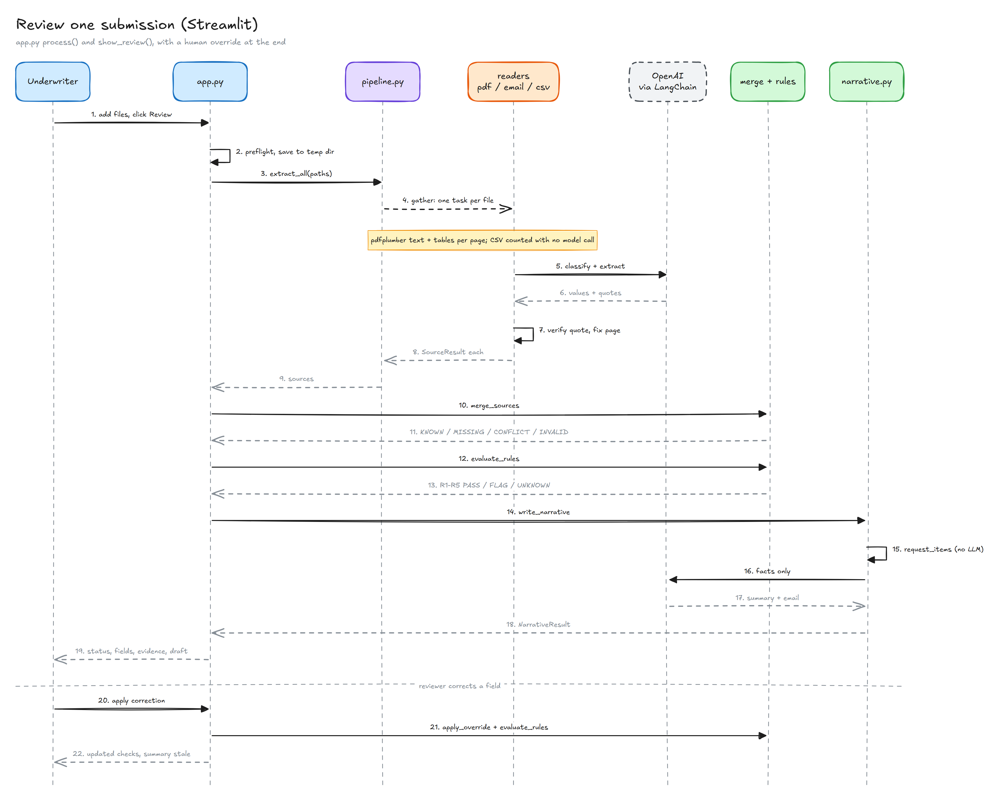
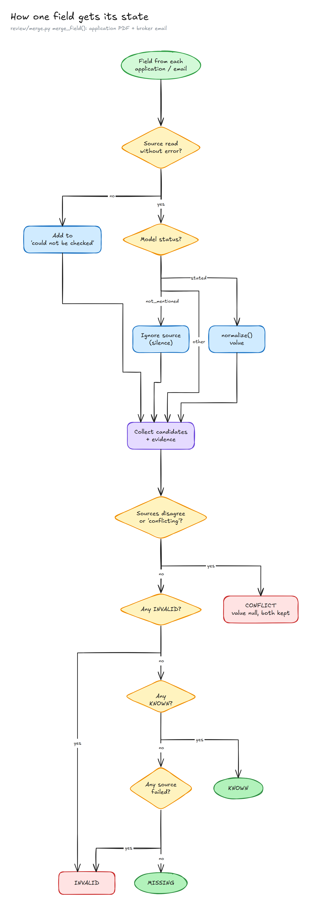

# Commercial Auto Submission Review

A small, locally run app that helps an underwriter review one commercial auto
submission: it reads the application PDF, broker email, vehicle schedule CSV and
loss runs report, extracts the required fields **with source evidence**, runs the
five supplied checks (R1–R5), and shows an AI-written underwriter summary plus an
**editable draft** email to the broker. Email is never sent.

The overall result (`READY_FOR_REVIEW` / `NEEDS_REVIEW`) only means readiness for
human review. It is not an approval, decline, quote, price or binding decision.

---

## Setup

Requires Python 3.12 (tested on 3.12.5, Windows 11). All dependencies, including
`openai`, are pinned in `requirements.txt`; a fresh virtual environment installed
from it passes the full test suite. On Windows, keep the virtual environment in a
reasonably short path: Streamlit contains deeply nested files that can exceed the
260-character path limit.

```bash
python -m venv .venv
# Windows:      .venv\Scripts\activate
# macOS/Linux:  source .venv/bin/activate
pip install -r requirements.txt

cp .env.example .env          # Windows: copy .env.example .env
# then edit .env and set OPENAI_API_KEY=sk-...
```

| Variable | Required | Purpose |
|---|---|---|
| `OPENAI_API_KEY` | yes | OpenAI key for extraction and the summary / draft email |
| `OPENAI_MODEL` | no | Defaults to `gpt-4o-mini` |
| `SAMPLES_DIR` | no | Folder containing `SUB-A`, `SUB-B`, `SUB-C`; adds a quick-pick in the app |

**Supplied data.** The sample packets are not copied into this repo. Point the
app at the `candidate_materials/sample_submissions` folder from the exercise
(via upload, the folder-path box, or `SAMPLES_DIR`).

## Run

```bash
streamlit run app.py                                  # browser app (http://localhost:8501)
python main.py path/to/sample_submissions/SUB-C       # command line, same pipeline
python main.py path/to/SUB-C --set operating_radius_miles=80   # with a human override
python main.py path/to/SUB-C --out review.json        # also save the full JSON
python -m pytest                                      # 136 tests, no API key or model calls
```

In the app, add one submission by any of four tabs (upload files, upload a
folder, type a folder path, or paste the broker email), click **Review
submission**, then:

- check each field's value, state and evidence (file, page / email body / CSV rows, quote);
- correct a field: it is labelled **HUMAN OVERRIDE**, the original value and evidence
  are kept, and the checks re-run immediately (Undo is available);
- regenerate and edit the draft broker email, then download it;
- click **Start new review** to load the next packet (no data is carried over).

Expected results on the samples:

| Packet | R1 | R2 | R3 | R4 | R5 | Overall |
|---|---|---|---|---|---|---|
| SUB-A | PASS | PASS | PASS | PASS | PASS | READY_FOR_REVIEW |
| SUB-B | FLAG (no date) | PASS | UNKNOWN (missing) | UNKNOWN (missing) | FLAG | NEEDS_REVIEW |
| SUB-C | PASS | FLAG (4 vs 3) | UNKNOWN (80 vs 180) | UNKNOWN (No vs Yes) | FLAG | NEEDS_REVIEW |

## Model and provider

- **OpenAI `gpt-4o-mini`** through **LangChain** (`langchain-openai` `ChatOpenAI`),
  temperature 0, strict JSON-schema structured output (pydantic models).
- The model is used for: (1) extracting fields from each PDF and email, (2)
  classifying each PDF as application / loss runs / other, (3) wording the
  underwriter summary and draft email.
- The rules, normalization, conflict detection, vehicle count and the list of
  items to request from the broker are ordinary deterministic code.

## AI coding tools used

- **Claude Code** (Anthropic, model Claude Opus 5.5) was used to plan, write and
  test the code step by step.

## Architecture



**Workflow of one review** in the app: files are read concurrently, the model
classifies and extracts with quotes, the quotes are verified, values are merged and
checked by R1–R5, then the summary and draft email are written. A human override
only re-runs merge and rules; the summary is marked stale until regenerated.



**How each field gets its state** (`review/merge.py`, `merge_field()`):



The diagrams are generated from the `.json` specs in `docs/diagrams/`; the
`.excalidraw` files open at excalidraw.com for editing, and `diagram-notes.md`
maps every box to its source files.

Module map:

```
app.py   (Streamlit UI)          main.py   (command line)
   └───────────────┬──────────────────┘
                   ▼
underwriting/pipeline.py        send each file to its reader, concurrently (asyncio)
   │
   ├─ extraction/               one SourceResult per file (values + evidence)
   │    pdf_reader.py           pdfplumber text+tables per page → LLM: classify + extract
   │    email_reader.py         .txt or pasted email → LLM extract
   │    csv_reader.py           count nonblank data rows (no LLM)
   │    schema.py, llm.py       pydantic schemas, quote check, LangChain/OpenAI call
   │
   └─ review/                   decision-ready view (no LLM except narrative)
        normalize.py            CA/California, 150 vs 150.0, Yes/No, dates…
        merge.py                one value per field: KNOWN / MISSING / CONFLICT / INVALID,
                                evidence, alternatives, sources checked, human overrides
        rules.py                R1–R5 + overall status
        narrative.py            items to request (rules) → LLM summary + draft email
underwriting/ui/style.py        neumorphic styling, high-contrast error cards
```

Key design decisions:

- **Evidence.** Every value carries file + locator + verbatim quote, checked twice
  in code: (1) the quote must exist in the file text (whole-word match; PDF page
  numbers are corrected to the page the quote is really on), and (2) the extracted
  value must appear in its quote, either through the reported wording (e.g.
  "California" -> CA) or in a common written form (150 / 150.0, No / false,
  2026-11-01 / 11/01/2026 / November 1, 2026). Failures are marked in red on the
  evidence line and summarised at the top of the review; they don't change the
  field state, so they can't cause false UNKNOWNs.
- **What the document said.** The model reports a status per field (`stated`,
  `not_provided`, `not_mentioned`, `conflicting`, `ambiguous`, `unparseable`), so
  "Not provided" becomes MISSING (R1 → FLAG) while an unusable answer becomes
  INVALID (→ UNKNOWN).
- **Conflicts.** When the application and email give different normalized values,
  both are kept with evidence, the value stays null (CONFLICT) and no source is
  preferred. A missing mention in one file is not a conflict.
- **PDFs are classified by content**, not file name; only applications supply the
  seven fields, and only a readable PDF classified as a loss runs report satisfies R5.
- **Loss runs (R5)** is decided from the actual attachments; an email promising
  them later does not count. An unreadable or unclassifiable attachment
  (including unsupported types such as `.docx`) gives UNKNOWN.
- **Failure handling.** A failed model call is shown per file with a plain-language
  fix; nothing is invented. Fields that could not be checked are INVALID (→ UNKNOWN),
  not MISSING. The CSV count, rules and request list still work without the model.
- **Untrusted input.** Document text is passed to the model inside `<document>`
  tags with instructions to ignore embedded instructions (tested with an injected
  instruction); the narrative model sees only resolved facts, never raw documents;
  all document text shown in the UI is HTML-escaped.
- **Packet isolation.** Each review replaces the whole session state; uploaded
  files live in a temporary folder only while being read.

## Tests

`python -m pytest` runs 136 tests without an API key or any model call. They cover
the required cases (missing information, a source conflict, unequal vehicle
counts, the 150-mile threshold) and also R1 precedence, invalid dates, zero
vehicles, harmless normalization, loss runs attachment logic (including an email
promise and unsupported attachments), overrides, the request list, narrative
failure handling, and the CSV counter.


## Known limitations

- Only text-based PDF, TXT and CSV files are read; scanned PDFs (OCR) are not
  supported. Other file types are listed as unreadable attachments.
- Every `.txt` file is treated as a broker email.
- The value-in-quote check knows common number, yes/no, state and date formats;
  an unusual format (e.g. "the first of November") would be flagged for review even
  if correct.
- The AI email is instructed to include every request item, but this is not
  verified automatically; the deterministic item list is shown next to it.
- Operations descriptions are compared as text (ignoring case and punctuation), so
  two paraphrases of the same activity would show as a conflict.
- Several CSVs with different counts are shown as a conflict rather than summed.
- A human override can set a value but cannot mark a field as "missing" again
  (use Undo instead).
- Extraction quality depends on the model; results can vary slightly between runs.
- State is kept in memory for the browser session only; there is no login or
  persistence (outside the assignment scope).
- The UI uses a light theme only.

